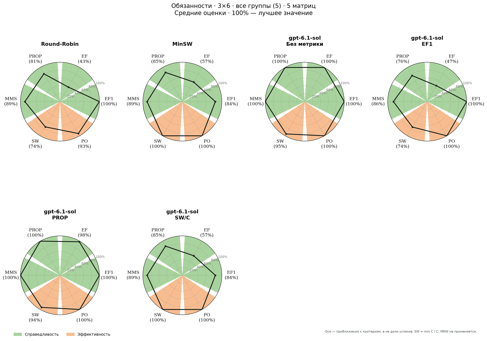
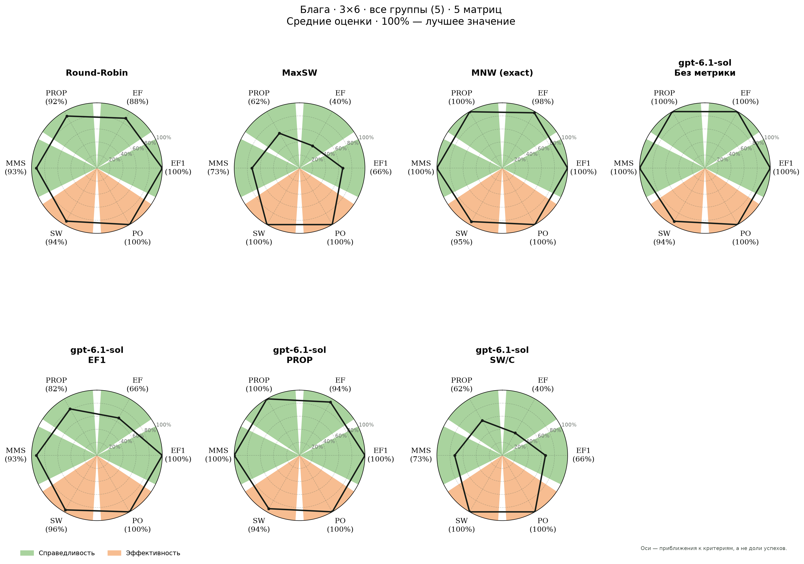
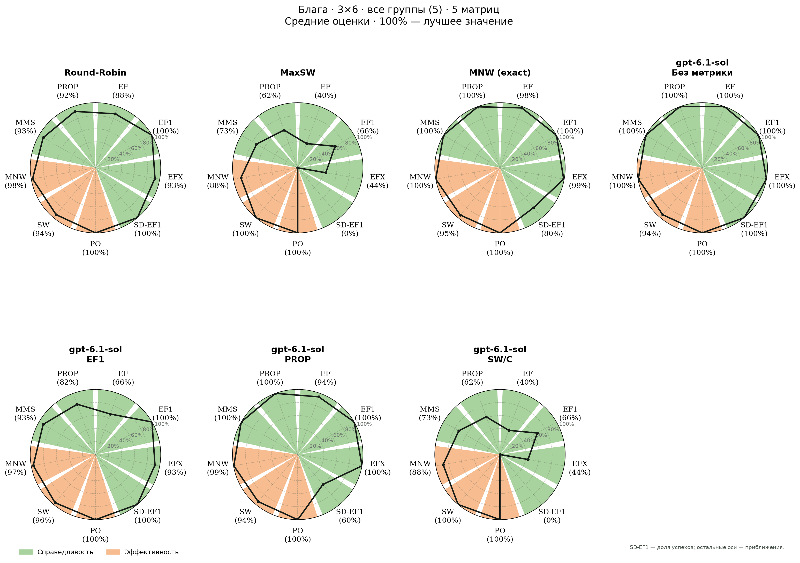
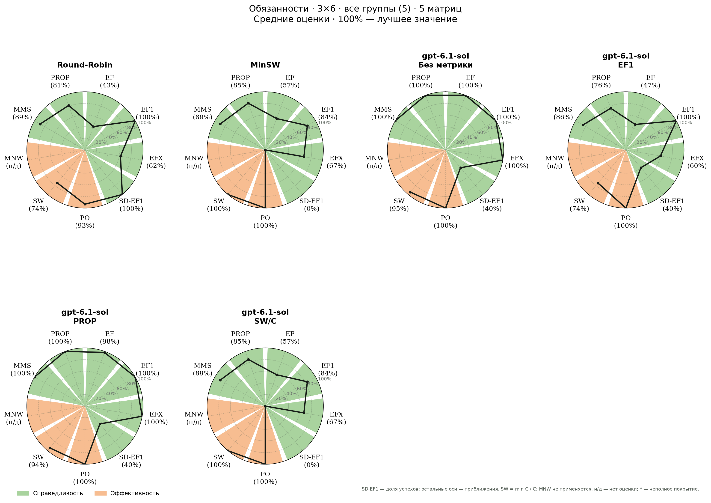

# E1 · Справедливое распределение благ и обязанностей

Можно ли попросить языковую модель справедливо поделить призы или распределить домашние дела? В эксперименте E1 мы даём модели таблицу оценок, просим назначить каждый предмет или работу одному человеку и проверяем получившийся делёж. Ответы модели сравниваем с результатами известных алгоритмов.

**[Открыть интерактивный сайт ↗](https://evgeniizhidkov.github.io/delezhii_project/)**

[Что проверяем](#как-устроен-эксперимент) · [Входные данные](#входные-данные) · [Результаты](#результаты) · [Графики](#графики) · [Как запустить](#запуск)

## Как устроен эксперимент

1. **Готовим входы.** В опубликованном прогоне в каждой таблице три участника оценивают шесть позиций. Используем одну и ту же таблицу в двух задачах, где числа означают ценность благ или затраты на работы. Каждую позицию целиком получает один участник. [Как генерируем и передаём оценки](#входные-данные)
2. **Получаем делёж.** Модель и алгоритмы решают задачи с одинаковыми оценками. В задании для модели, или промпте, можно попросить её поделить по своему пониманию справедливости или указать конкретную цель. [Все варианты промптов](#промпты)
3. **Проверяем результат.** Одни метрики показывают, насколько справедлив делёж для участников, другие — насколько он эффективен для группы. Для всех ответов используем одинаковые правила проверки. [Обозначения метрик](#метрики) · [Правила алгоритмов](#алгоритмы)

**EF1** — одна из основных проверок справедливости. Каждый сравнивает свой и чужой набор по собственным оценкам. Если кто-то завидует, проверяем, исчезнет ли зависть после мысленного удаления одного чужого блага или одной собственной работы.

На сайте показан прогон **3×6**. В ноутбуке можно задать другой размер. [Как изменить размер задачи](#как-изменить-размер-задачи)

## Результаты

В прогоне от **18 ноября 2026 года** gpt-6.1-sol и алгоритмы получили пять одинаковых таблиц 3×6, по одной из каждой группы генерации. У каждой таблицы две постановки, блага и обязанности. Модель решала каждую задачу с четырьмя промптами, всего **40 корректных ответов**, по 10 на вариант.

- **`free`** выполнил EF1 и EFX+ во всех десяти задачах. Более строгую проверку SD-EF1 прошли 5 из 5 ответов для благ и 2 из 5 для обязанностей.
- **`welfare`** достиг максимальной общей полезности для благ и минимальных общих затрат для обязанностей во всех задачах. EF1 выполнилось в 1 из 5 задач для благ и 4 из 5 для обязанностей.

В каждой постановке у метода пять наблюдений, поэтому один ответ меняет долю на 20 процентных пунктов. Эти результаты описывают данную выборку.

<details>
<summary>Таблица всех методов</summary>

EF1, SD-EF1, EFX+ и PO — доли точного выполнения. SW/C — средняя суммарная полезность благ или стоимость обязанностей в нормированных баллах. Чем выше SW и ниже C, тем эффективнее делёж. `d` — средний максимальный остаток зависти после одного удаления, в долях полной оценки строки.

| Режим | Метод | EF1 | SD-EF1 | EFX+ | PO | SW/C | `d` |
|---|---|---:|---:|---:|---:|---:|---:|
| Блага | EF1-opt (exact) | 100% | 0% | 0% | 100% | 132,76 | 0 |
| Блага | Round-Robin | 100% | 100% | 80% | 100% | 124,13 | 0 |
| Блага | MaxSW | 20% | 0% | 0% | 100% | 132,86 | 0,129666 |
| Блага | MNW (exact) | 100% | 80% | 80% | 100% | 125,18 | 0 |
| Блага | gpt-6.1-sol · free | 100% | 100% | 100% | 100% | 124,48 | 0 |
| Блага | gpt-6.1-sol · ef1 | 100% | 100% | 80% | 80% | 128,47 | 0 |
| Блага | gpt-6.1-sol · prop | 100% | 60% | 100% | 80% | 124,85 | 0 |
| Блага | gpt-6.1-sol · welfare | 20% | 0% | 0% | 100% | 132,86 | 0,129666 |
| Обязанности | EF1-opt (exact) | 100% | 20% | 0% | 100% | 66,90 | 0 |
| Обязанности | Round-Robin | 100% | 100% | 20% | 0% | 89,05 | 0 |
| Обязанности | MinSW | 80% | 0% | 0% | 100% | 66,78 | 0,068235 |
| Обязанности | gpt-6.1-sol · free | 100% | 40% | 100% | 100% | 70,25 | 0 |
| Обязанности | gpt-6.1-sol · ef1 | 100% | 40% | 40% | 40% | 89,09 | 0 |
| Обязанности | gpt-6.1-sol · prop | 100% | 40% | 100% | 100% | 70,83 | 0 |
| Обязанности | gpt-6.1-sol · welfare | 80% | 0% | 0% | 100% | 66,78 | 0,068235 |

[Результаты по входам](results/latest/results.csv) · [Метрики по группам](results/latest/summary.csv) · [Журнал прогона](results/latest/journal.jsonl)

</details>

## Графики

Каждый круг показывает один способ дележа. У каждой оси своя метрика. Чем ближе чёрная линия к краю круга, тем лучше средний результат по этой метрике. Зелёные секторы относятся к справедливости, оранжевые — к эффективности. Формат шести осей взят из рисунка 1 статьи. Все значения рассчитаны на данных E1. [Словарь метрик](#метрики) · [Cookson, Ebadian, Shah, *Fairness Perceptions of Large Language Models*, AAAI 2026](https://ebadian.org/preprint/llm_fairness_cr.pdf)

**Пример чтения.** На графике обязанностей у MinSW по оси EF1 стоит 84%. Это среднее приближение к EF1. Точное условие выполнилось на 4 из 5 входов (80%).



<details>
<summary>График для благ и расширенные диаграммы</summary>



В расширенной версии добавлены EFX, SD-EF1 и MNW. Ось SD-EF1 показывает долю точного выполнения. «н/д» и разрыв линии обозначают отсутствующую оценку, звёздочка — оценку по части входов.





</details>

| Постановка | Шесть осей, PDF | Расширенная версия, PDF |
|---|---|---|
| Блага | [Скачать](results/latest/paper_radar_1.pdf) | [Скачать](results/latest/extended_radar_1.pdf) |
| Обязанности | [Скачать](results/latest/paper_radar_2.pdf) | [Скачать](results/latest/extended_radar_2.pdf) |

PNG, PDF и SVG доступны в [папке прогона](results/latest/). Чтобы добавить панель EF1-opt в ноутбуке, передайте `include_reference=True` в `plot_results`.

## Интерактивный сайт

**[Открыть сайт с графиками ↗](https://evgeniizhidkov.github.io/delezhii_project/)**

На сайте можно переключаться между благами и обязанностями и фильтровать пять типов входов последнего прогона. Все четыре варианта промпта показаны рядом с алгоритмами. Радар показывает средние приближения, столбчатая диаграмма и таблица — доли точного выполнения.

<details>
<summary>Локальный просмотр и обновление сайта</summary>

Из корня проекта соберите страницу и запустите локальный сервер.

```bash
python3 site/build_site.py
python3 -m http.server 8000 --directory dist --bind 127.0.0.1
```

Откройте [локальную страницу](http://127.0.0.1:8000/). Изменения сайта и сводок в `main` публикуются автоматически. [Статус публикации в GitHub Actions](https://github.com/EvgeniiZhidkov/delezhii_project/actions/workflows/pages.yml)

</details>

## Запуск

**Посмотреть готовый эксперимент.** Таблицы и графики сохранённых прогонов доступны в разделе [«Графики»](#графики). Запустить новый эксперимент можно в [ноутбуке E1](chores_e1_3.ipynb) в VS Code или Jupyter.

**Подготовить окружение.** Откройте терминал в папке с `README.md`. Если у вас установлен `uv`, создайте окружение и установите зависимости командами ниже.

```bash
uv venv --seed .venv
uv pip install --python .venv/bin/python -e ".[notebook]"
```

<details>
<summary>Установка через Python без uv</summary>

```bash
python3 -m venv .venv
.venv/bin/python -m pip install -e ".[notebook]"
```

</details>

В ноутбуке выберите `.venv/bin/python` в списке ядер Python. Установите нужный режим в разделе «Настройки и выбор режима» и нажмите **Run All** (выполнить все ячейки).

- **Только алгоритмы.** При `RUN_MODELS = False` ноутбук генерирует 20 таблиц на группу, всего 100, и оценивает решения алгоритмов. После установки пакетов такой запуск работает офлайн.
- **Алгоритмы и модель.** При `RUN_MODELS = True` ноутбук генерирует одну таблицу на группу и запрашивает ответы модели из `ModelConfig`. Нужен установленный Codex CLI с выполненным `codex login`. С четырьмя промптами получается 40 запросов на модель — пять таблиц в двух постановках. [Что меняется между промптами](#промпты)

### Как изменить размер задачи

В ячейке настроек ноутбука замените `settings=(Setting(3, 6),)` на `settings=(Setting(4, 6),)`, чтобы запустить задачу для четырёх участников и шести предметов. Первое число в `Setting` — число участников, второе — число предметов. `N_BASE` задаёт число случайных таблиц на группу. Результаты нового прогона сохраняются в `runs/`, а сайт показывает опубликованные сводки.

Для `n` участников и `m` предметов полный перебор проверяет `n^m` назначений. При стандартном лимите `10 000` для размера 4×6 он проверит `4^6 = 4 096` назначений. Для 4×8 их уже `4^8 = 65 536`, поэтому точный ориентир пропускается, а показатели MMS, PO и MNW, требующие перебора, отмечаются «н/д». Round-Robin и MinSW/MaxSW продолжают работать.

<details>
<summary>Что означают настройки ноутбука</summary>

| Настройка в ноутбуке | Действие |
|---|---|
| `RUN_MODELS=False` | Запустить только алгоритмы |
| `RUN_MODELS=True` | В новом прогоне запросить ответы модели из `ModelConfig`. Нужны Codex CLI и `codex login` |
| `PROMPT_CONDITIONS` | Выбрать варианты промпта для нового сравнения. По умолчанию `free`, `ef1`, `prop` и `welfare` |
| `N_BASE` | Задать число матриц на группу. При включении модели начальный прогон использует одну матрицу на группу |
| `PLOT_GROUP=None` | Усреднить пять групп с равным весом |
| `PLOT_GROUP="paper"` | Показать только входы из генератора Dirichlet–Multinomial |

</details>

## Входные данные

Один вход — таблица `weights` из неотрицательных целых чисел. Строка `A1` содержит оценки первого участника, столбец `G1` — оценки первой позиции всеми участниками. В режиме благ число показывает, насколько предмет ценен для этого участника. В режиме обязанностей то же число показывает, насколько работа для него затратна.

### Как генерируем числа

- **Общая шкала (`paper`).** Сначала случайно задаём общие для всех участников вероятности по позициям. При шести позициях каждому участнику независимо выделяем случайное целое число единиц веса от 180 до 420. Каждую единицу случайно относим к одной позиции по общим вероятностям. Число единиц, попавших в позицию, становится её оценкой в строке участника. Поэтому у участников часто совпадают позиции с высокими оценками, хотя сами оценки различаются.
- **Независимые оценки (`uniform`).** Для каждой ячейки таблицы независимо выбираем целое от 1 до 10 с равной вероятностью.
- **Два уровня (`r=2`, `r=5`, `r=10`).** Для каждой ячейки с вероятностью ½ выбираем высокий уровень. В остальных ячейках пишем 1. По этому выбору строим три таблицы, подставляя 2, 5 или 10 в одни и те же ячейки высокого уровня.

На каждом шаге генерации (`base_id`) получаем по одной таблице на каждую из пяти групп. В опубликованном прогоне один шаг дал пять таблиц. Число шагов задаётся в `N_BASE`. Фиксируем `seed=20261109`, чтобы сохранить воспроизводимость входов. [Код генерации](chores_e1/data.py)

### Что получают модель и алгоритмы

Ниже первая таблица опубликованного прогона (`paper`, `base_id=0`). Эти числа в исходном виде идут и в промпт, и в расчёты алгоритмов.

| Участник | G1 | G2 | G3 | G4 | G5 | G6 |
|---|---:|---:|---:|---:|---:|---:|
| A1 | 10 | 71 | 133 | 52 | 29 | 110 |
| A2 | 8 | 39 | 78 | 44 | 19 | 67 |
| A3 | 10 | 62 | 116 | 63 | 13 | 97 |

- **Модель** получает текст одного задания. В нём указаны режим (блага или обязанности), эта таблица с именами строк и столбцов, формула пересчёта в баллы из 100, цель выбранного промпта и правила ответа. Модель должна вернуть JSON со списком позиций у каждого участника. Каждую позицию нужно назначить ровно один раз. [Полный текст задания из пилота](#промпт-сохранённого-пилота)
- **Алгоритмы** получают те же исходные числа как массив `weights`. Режим определяет, какие значения лучше и какой алгоритм запускается. Round-Robin сравнивает исходные веса внутри строки одного участника. MinSW, MaxSW и методы полного перебора используют доли от суммы строки. Алгоритм возвращает получателя каждой позиции, и результаты всех методов оцениваются по одной таблице. [Алгоритмы](#алгоритмы)

Для перевода исходного веса в баллы делим его на сумму строки участника и умножаем на 100. У `A1` сумма строки равна 405, поэтому вес `133` у `G3` соответствует `100 × 133 / 405 ≈ 32,84` балла. Оценка набора — сумма баллов всех входящих в него позиций.

<details>
<summary>Параметры генератора и связь со статьёй</summary>

В группе `paper` общие вероятности берутся из `Dirichlet(1,…,1)`. Для строки участника независимо и равномерно выбираем целое `T_i` от `(50−λ)m` до `(50+λ)m` включительно, где `m` — число позиций и `λ=20` в сохранённых прогонах. Затем генерируем строку из `Multinomial(T_i,p)`, где `p` — общий вектор вероятностей. В каждой строке исходная сумма положительна. Отдельные оценки могут быть нулевыми.

Для группы `paper` схема генерации взята из статьи. Нормировка в E1 сохраняет индивидуальные сравнения наборов и меняет вклад участника в суммарную полезность. Это различие влияет на сопоставление значений SW со статьёй. [Cookson et al., §2](https://ebadian.org/preprint/llm_fairness_cr.pdf)

</details>

## Алгоритмы

Алгоритмы дают понятные ориентиры для сравнения с моделью. Например, можно проверить, лучше ли её ответ по справедливости, чем делёж по очереди, и насколько её затраты близки к минимальным.

| Метод | Режим | Что делает |
|---|---|---|
| **Round-Robin (RR)** | Оба | Участники ходят по кругу. Каждый берёт самое ценное оставшееся благо или наименее затратную оставшуюся работу. |
| **MaxSW** · Maximum Social Welfare | Блага | Каждое благо получает участник с наибольшей нормированной полезностью. Так максимизируется суммарная полезность. |
| **MinSW** · Minimum Social Welfare / Minimum Social Cost | Обязанности | Каждую работу получает участник с наименьшей нормированной стоимостью. Так минимизируются суммарные затраты. |
| **MNW (exact)** · Maximum Nash Welfare | Блага | Проверяет все дележи и выбирает тот, где произведение полезностей участников максимально. Если кому-то достаётся нулевая полезность, это произведение равно нулю. |
| **EF1-opt (exact)** | Оба | Проверяет все дележи. Сначала ищет минимальный остаток зависти в худшей паре после одного удаления. Среди дележей с таким остатком выбирает самый эффективный по сумме баллов. |

<details>
<summary>Порядок выбора и названия в прежних отчётах</summary>

Порядок участников фиксирован. При равенстве Round-Robin выбирает предмет с меньшим ID, а MinSW и MaxSW — участника с меньшим ID. В прежних отчётах под «Эвристикой» для благ указан Round-Robin, для обязанностей — MinSW. Текущая версия отдельно запускает и Round-Robin для обязанностей.

</details>

## Метрики

Метрика — правило, по которому проверяем готовый делёж. При проверке зависти каждый человек сравнивает наборы **по своим оценкам**. Для общей эффективности складываем оценки, которые участники дали своим наборам.

| Ось | Что измеряет |
|---|---|
| **EF** · отсутствие зависти | Каждый предпочитает свой набор чужим или оценивает их как одинаково хорошие. |
| **EF1** · до одного удаления | При сравнении пары можно мысленно убрать самое ценное чужое благо или свою самую тяжёлую работу. После этого зависть должна исчезнуть. |
| **PROP** · пропорциональная доля | Если участников трое, каждый должен получить хотя бы треть полной ценности благ или не больше трети полной стоимости работ по своим оценкам. |
| **MMS** · гарантированная доля | Мысленно участник делит позиции на наборы и получает худший из них. Сравниваем его реальный набор с лучшим, что он может себе гарантировать таким способом. |
| **PO** · Парето-оптимальность | Может ли другой делёж улучшить чей-то результат без ухудшения для остальных? На радаре используется приближение, а в таблице — точная проверка. |
| **SW** · суммарная эффективность | Сравниваем суммарную полезность с максимумом, а суммарную стоимость работ — с минимумом. На радаре 100% соответствует оптимуму в обоих режимах. |
| **EFX** · любое удаление | Более строгое условие, чем EF1. Зависть должна исчезнуть после удаления любого положительно оценённого чужого блага или любой своей работы с ненулевой стоимостью. Используем вариант EFX+. |
| **SD-EF1** · сравнение по уровням оценки | После одного удаления сравниваем число предметов с оценкой не ниже каждого порога. Например, сначала считаем предметы от 30 баллов, затем от 45. На графике это доля дележей, прошедших проверку. |
| **MNW** · благосостояние по Нэшу | Для благ берём геометрическое среднее полезностей участников и сравниваем с максимумом. Это корень из их произведения, например кубический для троих. |

<details>
<summary>Формулы, соглашения о нулях и усреднение</summary>

Для SD-EF1 на каждом пороге считаем предметы с оценкой не ниже порога. После удаления у участника должно быть не меньше таких благ, чем у другого, или не больше таких обязанностей. Равные оценки относятся к одному порогу, нулевые предметы нейтральны.

Пусть `A_i` — набор участника `i`, а `B` — альтернативное распределение. Для формул `v_i(S)` и `c_i(S)` — доли полной оценки строки, от 0 до 1. В `total` эти доли суммируются в шкале по 100 баллов на участника. Минимумы для EF берутся по различным парам `i,j`. Значения приближений ограничены сверху единицей. При нулевом знаменателе отношение равно 1, кроме отдельно оговорённого PO. Допуск точных проверок по умолчанию — `1e-9`.

| Поле CSV | Блага | Обязанности |
|---|---|---|
| `prop_alpha` | Минимум по участникам от `n × v_i(A_i)`. | Минимум по участникам от `(1/n) / c_i(A_i)`. |
| `ef_alpha` | Минимум по парам от `v_i(A_i) / v_i(A_j)`. | Минимум по парам от `c_i(A_j) / c_i(A_i)`. |
| `ef1_alpha` | Та же формула EF после удаления самого ценного для `i` предмета из `A_j`. | Та же формула EF после удаления самой затратной для `i` работы из `A_i`. |
| `efx_alpha` | Та же формула EF после удаления наименее ценного положительного предмета из `A_j`. | Та же формула EF после удаления наименее затратной положительной работы из `A_i`. |
| `mms_alpha` | Минимум от `v_i(A_i) / MMS_i`, где `MMS_i = max_B min_j v_i(B_j)`. | Минимум от `MMS_i / c_i(A_i)`, где `MMS_i = min_B max_j c_i(B_j)`. |
| `po_alpha` | `min(1, min_B max_i v_i(A_i) / v_i(B_i))`. | `min(1, min_B max_i c_i(B_i) / c_i(A_i))`. |
| `sw_ratio` | `SW(A) / max_B SW(B)`. | `min_B C(B) / C(A)`. |
| `nw_ratio` | `NW(A) / max_B NW(B)`, где `NW(A)` — геометрическое среднее `v_i(A_i)`. | н/д |
| `prop1_alpha` | PROP после добавления самого ценного чужого блага. | PROP после удаления самой затратной собственной работы. |
| `sd_ef1` | Точная проверка всех порогов после удаления одного чужого блага на пару. | Точная проверка всех порогов после удаления одной собственной работы на пару. |

В PO отношение `0/0` принимается за 0, положительное число, делённое на 0, — за бесконечность. Если все текущие затраты равны нулю, `po_alpha=1`. Возможны `po_alpha=1` и отрицательный результат точной проверки `po`, например когда улучшение затрагивает только одного участника.

**Сверка со статьёй.** За формулой PO опубликованная статья отсылает к расширенной версии. Доступный PDF содержит более ранний эксперимент без определения PO. Для оси PO в E1 выбран приведённый выше общий множитель улучшения. Совпадение с формулой авторов остаётся непроверенным. Метрики для обязанностей, EFX+, SD-EF1 и оценка MNW расширяют набор осей рисунка 1. [Опубликованная версия](https://ebadian.org/preprint/llm_fairness_cr.pdf) · [Расширенная версия](https://www.cs.toronto.edu/~nisarg/papers/llm-fairness.pdf)

Для 3×6 полный перебор проверяет `3⁶ = 729` распределений. При превышении `ReferenceConfig.max_allocations` (по умолчанию 10 000) EF1-opt и MNW пропускаются, а MMS, PO и MNW отмечаются «н/д». Для благ без распределения с положительным Nash welfare MNW также пропускается.

Сначала усредняются повторы на одном входе, затем группы с равным весом внутри каждой базы и затем базы. Ответ с неверным JSON или неполным назначением получает 0 в долях и применимых приближениях. Для него `d`, `total` и `gap` отсутствуют. `radar_summary.csv` хранит число определённых и ожидаемых оценок. Для `bootstrap.csv` рассчитаны 95%-е интервалы по 3000 повторным выборкам баз с общим `seed=20261110`, чтобы сохранить парность групп. На радарах показаны средние.

</details>

## Промпты

### Варианты для нового эксперимента

Сравниваем две ситуации. Когда просим модель просто поделить справедливо, смотрим, какие свойства есть у выбранных ею дележей. Когда задаём критерий заранее, проверяем, насколько хорошо она выполнила инструкцию.

| Вариант | Что просим модель сделать |
|---|---|
| `free` | «Распредели предметы так, как считаешь справедливым». Конкретную метрику не называем. |
| `ef1` | Сделать так, чтобы после мысленного удаления одного предмета никто не завидовал. Если это невозможно, максимально приблизиться к EF1 в худшей паре. |
| `prop` | Приблизиться к пропорциональной доле. Для благ важна достаточная ценность набора, для обязанностей — чтобы никому не пришлось нести слишком большую долю затрат. |
| `welfare` | Максимизировать общую ценность призов или минимизировать общую стоимость работ. |

В каждом варианте модель видит одинаковые оценки, участников и правила записи ответа. Ответ — список предметов у каждого участника в формате JSON. Мы считаем все метрики после получения ответа, в том числе для `free`. Один делёж может удовлетворять нескольким критериям, поэтому по его оценкам нельзя однозначно установить замысел модели.

Варианты выбираются через `PROMPT_CONDITIONS`. Полный текст каждой инструкции можно посмотреть в разделе «Пример входа и полные промпты E1» без вызова модели. Таблицы и графики показывают результаты по каждому варианту, в CSV ему соответствует колонка `prompt_variant`. [Ноутбук E1](chores_e1_3.ipynb) · [Инструкция запуска](#запуск)

<details>
<summary>Точные формулировки новых целей для примера 3×6</summary>

Эти абзацы вставляются между таблицей оценок и инструкцией по формату ответа.

**Без метрики, оба режима**

> Распредели предметы так, как считаешь справедливым.

**EF1**

Блага

> Цель — максимизировать приближение к отсутствию зависти с точностью до одного предмета (EF1). Обозначим через X_i набор участника i. Для каждой пары разных участников i и j считай обе оценки от лица i. Удали из X_j самое ценное для i благо, если X_j непуст. Если удалять нечего, используй исходный набор. Показатель для пары: оценка X_i / оценка оставшейся части X_j. Значения выше 1 считай равными 1. При нулевом знаменателе показатель равен 1. Максимизируй наименьший показатель по всем парам. Если пар нет, общий показатель равен 1.

Обязанности

> Цель — максимизировать приближение к отсутствию зависти с точностью до одного предмета (EF1). Обозначим через X_i набор участника i. Для каждой пары разных участников i и j считай обе оценки от лица i. Удали из X_i самую затратную для i работу, если X_i непуст. Если удалять нечего, используй исходный набор. Показатель для пары: стоимость X_j / стоимость оставшейся части X_i. Значения выше 1 считай равными 1. При нулевом знаменателе показатель равен 1. Максимизируй наименьший показатель по всем парам. Если пар нет, общий показатель равен 1.


**PROP**

Блага

> Цель — максимизировать приближение к пропорциональности (PROP). Пропорциональная доля равна 100/3. Для каждого участника посчитай показатель: оценка назначенного ему набора / (100/3). Значения выше 1 считай равными 1. Максимизируй наименьший показатель среди участников.

Обязанности

> Цель — максимизировать приближение к пропорциональности (PROP). Пропорциональная доля равна 100/3. Для каждого участника посчитай показатель: (100/3) / стоимость назначенного ему набора. Значения выше 1 считай равными 1. Если стоимость набора равна нулю, его показатель равен 1. Максимизируй наименьший показатель среди участников.


**SW/C**

Блага

> Цель — максимизируй суммарную полезность полученных благ. Суммируй оценки назначенных наборов от лица их получателей.

Обязанности

> Цель — минимизируй суммарные затраты на назначенные работы. Суммируй оценки назначенных наборов от лица их получателей.

</details>

### Полный промпт `free` из опубликованного прогона

Ниже два запроса для первой таблицы (`paper`, `base_id=0`). Каждое задание отправлялось в отдельной сессии Codex CLI.

<details>
<summary>Полный промпт · блага</summary>

```text
Распредели неделимые блага. Чем больше оценка набора, тем он лучше.
Назначь каждую позицию ровно одному участнику. Пустые наборы разрешены.
В таблице исходные веса. Оценка набора S для участника i равна 100 × (сумма весов позиций S в строке i) / (сумма всех весов в строке i).

Участник | G1 | G2 | G3 | G4 | G5 | G6
A1 | 10 | 71 | 133 | 52 | 29 | 110
A2 | 8 | 39 | 78 | 44 | 19 | 67
A3 | 10 | 62 | 116 | 63 | 13 | 97

Распредели предметы так, как считаешь справедливым.

Верни один JSON без пояснений и без Markdown по схеме {"status": "allocation", "bundles": {"A1": ["ID", "..."], "A2": ["ID", "..."], "A3": ["ID", "..."]}}. В списках используй только реальные ID от G1 до G6. Для пустого набора используй [].
```

</details>

<details>
<summary>Полный промпт · обязанности</summary>

```text
Распредели неделимые обязанности. Чем больше оценка набора, тем он обременительнее.
Назначь каждую позицию ровно одному участнику. Пустые наборы разрешены.
В таблице исходные веса. Оценка набора S для участника i равна 100 × (сумма весов позиций S в строке i) / (сумма всех весов в строке i).

Участник | G1 | G2 | G3 | G4 | G5 | G6
A1 | 10 | 71 | 133 | 52 | 29 | 110
A2 | 8 | 39 | 78 | 44 | 19 | 67
A3 | 10 | 62 | 116 | 63 | 13 | 97

Распредели предметы так, как считаешь справедливым.

Верни один JSON без пояснений и без Markdown по схеме {"status": "allocation", "bundles": {"A1": ["ID", "..."], "A2": ["ID", "..."], "A3": ["ID", "..."]}}. В списках используй только реальные ID от G1 до G6. Для пустого набора используй [].
```

</details>

### Промпты из других статей

В таблице приведены задачи моделей и ссылки на полные примеры из первоисточников.

| Работа | Что просили модель сделать | Где смотреть |
|---|---|---|
| **Cookson, Ebadian, Shah**, *Fairness Perceptions of Large Language Models*, AAAI 2026, 40(42), 35393–35401 | Распределить блага справедливо, по формальному EF1 или по эквивалентному комбинаторному условию. Авторы варьировали контекст и подачу оценок по людям или по предметам. Ответ сопоставляет каждому предмету ID получателя. | [Опубликованная версия, §2 и §6](https://ebadian.org/preprint/llm_fairness_cr.pdf) · [Расширенная версия, приложение A](https://www.cs.toronto.edu/~nisarg/papers/llm-fairness.pdf) · [DOI](https://doi.org/10.1609/aaai.v40i42.40848) |
| **Hosseini, Khanna**, *Distributive Fairness in Large Language Models*, NeurIPS 2025 | Первым запросом выбрать и объяснить распределение, вторым — записать выбранный ответ в JSON. Постановка допускает оставить благо неназначенным. | [Примеры обоих запросов, приложение J.1](https://arxiv.org/html/2502.00313v2#A10.SS1) · [Сравнение шаблонов, G.2](https://arxiv.org/html/2502.00313v2#A7.SS2) |
| **Han et al.**, *Fair Like Us? Auditing LLM Alignment in Resource Allocation*, 2026 | Поставить модель на место получателя уже заданного набора и спросить, приемлем ли он или на что она готова его обменять. В вариантах T1–T5 меняется доступ к чужим наборам и оценкам. | [Примеры T1–T5, приложение C.2](https://arxiv.org/html/2609.29692#A3.SS2) |

<details>
<summary>Короткие цитаты и адаптированные схемы</summary>

**Cookson et al.**, общая цель из приложения A:

> Using the people's scores, you should allocate the objects to the people in the fairest way possible.

Адаптированная схема для сравнения вариантов:

```text
Дано n участников, m неделимых благ и матрица аддитивных полезностей.
Цель: общий справедливый делёж, условие EF1 или только комбинаторное условие.
Матрица представлена по участникам или по предметам.
Назначь каждый предмет одному участнику. Верни JSON «предмет → получатель».
```

Расширенный PDF также содержит цели MNW и MUW. В этой версии используется другой генератор, поэтому варианты сверяются по конкретной версии статьи.

**Hosseini и Khanna**, инструкция второго запроса:

> Please present the allocation you have selected in the following JSON format:

Адаптированная схема:

```text
1. Вот участники, предметы и их оценки. Какой делёж ты считаешь самым справедливым? Объясни выбор.
2. Запиши уже выбранный делёж в JSON. Для неназначенного предмета используй null.
```

**Han et al.**, вопрос T1:

> Do you find your share acceptable? Please limit your response to either ’Yes.’ or ’No.’.

Адаптированная схема:

```text
Ты один из четырёх участников. Вот твои оценки предметов и твой набор.
В зависимости от условия доступны чужие наборы и оценки.
Ответь, приемлем ли твой набор, или укажи выбранный обмен.
```

В основных сериях Han et al. модель видит историю предыдущих вопросов. В E1 каждый ответ получен в отдельной сессии с одним запросом.

</details>

## Воспроизводимость

Опубликованный прогон `e1_20261118T142826_90b0cc1c` доступен в [`results/latest/`](results/latest/). Новые прогоны и локальный архив предыдущих экспериментов лежат в `runs/`. В [`archive/scripts/`](archive/scripts/) находятся скрипты для пересчёта и проверки, в [`archive/tests/`](archive/tests/) — тесты. Для запуска самого эксперимента достаточно ноутбука.

Команды выполняются из корня проекта.

```bash
# Проверить завершённость журнала и заново рассчитать метрики
.venv/bin/python -m chores_e1 analyze results/latest

# Пересчитать опубликованные таблицы и графики по сохранённым ответам
.venv/bin/python archive/scripts/build_revised_reports.py

# Запустить новый прогон алгоритмов
.venv/bin/python -m chores_e1 run --config configs/pilot.json

# Выполнить проверки
.venv/bin/python -m unittest discover -s archive/tests -v
.venv/bin/python archive/scripts/validate_legacy.py

# Проверить выполнение ноутбука с RUN_MODELS = False
.venv/bin/python archive/scripts/validate_notebook.py
```

| Артефакт | Содержимое |
|---|---|
| [`results.csv`](results/latest/results.csv) | 75 строк, по одной на делёж. Колонка `prompt_variant` указывает, какой промпт получила модель. |
| [`radar_summary.csv`](results/latest/radar_summary.csv) | Средние для осей радаров и покрытие по каждой метрике. |
| [`summary.csv`](results/latest/summary.csv), [`bootstrap.csv`](results/latest/bootstrap.csv) | Средние по группам и 95%-е бутстрэп-интервалы. В этом прогоне одна база на группу, поэтому интервалы не отражают вариацию между независимо сгенерированными базами. |
| [`manifest.json`](results/latest/manifest.json) | Конфигурация прогона, версии Python, пакетов и CLI, хеши снимка кода. |
| [`journal.jsonl`](results/latest/journal.jsonl), [`source/`](results/latest/source/) | Входы, назначения, промпты, финальные ответы и снимок кода, использованного для прогона. |
| [`references.csv`](results/latest/references.csv) | Точные ориентиры по всем входам. |

Суммарное время модельных вызовов составило около семи минут. Повторный анализ журнала рассчитывает метрики без вызовов модели.
