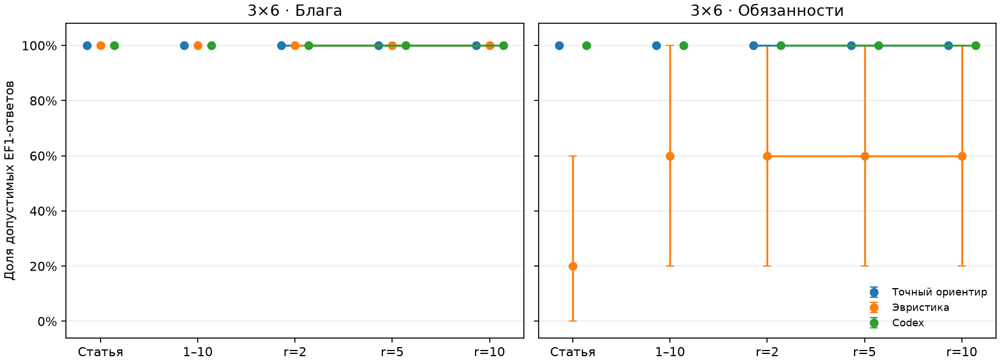
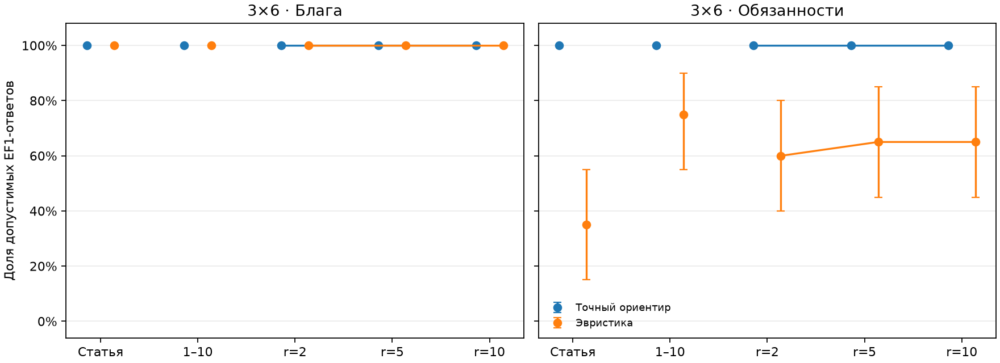

# Опубликованные результаты E1

Два завершённых прогона на аддитивных оценках. Оба проверены повторным чтением журналов; исходные метрики совпали с пересчётом. Для каждого прогона сохранены исходные данные, распределения, настройки и снимок кода, а также таблицы и графики с бутстрэп-интервалами.

| Прогон | Матриц | Задач goods/chores | Строк результатов | Ответов модели |
|---|---:|---:|---:|---:|
| [GPT-6.1 Sol](model_gpt-6.1-sol/) | 25 | 50 | 150 | 50 |
| [Алгоритмы, 20 баз на группу](algorithms_3x6_n20/) | 100 | 200 | 400 | 0 |

Все входы имеют размер 3×6, пять групп и seed=20261109. Первые пять баз в алгоритмическом прогоне совпадают с входами модельного пилота; это дополнительно проверено при публикации. Эффект увеличения выборки нельзя смешивать с различием алгоритмов: прямое сравнение модели и алгоритмов на одинаковых входах уже есть внутри модельного прогона.

## Модельный пилот

| Метод | Режим | Матриц | EF1 | SD-EF1 | Средний d | Средний SW / C |
|---|---|---:|---:|---:|---:|---:|
| Точный ориентир | Блага | 25 | 100% | 36% | 0.000000 | 138.4514 |
| Эвристика | Блага | 25 | 100% | 100% | 0.000000 | 127.8505 |
| Codex | Блага | 25 | 100% | 48% | 0.000000 | 138.3800 |
| Точный ориентир | Обязанности | 25 | 100% | 36% | 0.000000 | 64.0635 |
| Эвристика | Обязанности | 25 | 52% | 12% | 0.062580 | 63.3169 |
| Codex | Обязанности | 25 | 100% | 36% | 0.000000 | 64.0635 |

Модель выполнила EF1 во всех 50 задачах. Более сильная SD-EF1 выполнена в 48% задач благ и 36% задач обязанностей. По стоимости обязанностей все ответы совпали с точным ориентиром; по полезности благ — 24 из 25. Это небольшой пилот с пятью базами на группу.

## Более широкая алгоритмическая выборка

| Метод | Режим | Матриц | EF1 | SD-EF1 | Средний d | Средний SW / C |
|---|---|---:|---:|---:|---:|---:|
| Точный ориентир | Блага | 100 | 100% | 41% | 0.000000 | 140.9798 |
| Эвристика | Блага | 100 | 100% | 100% | 0.000000 | 129.2518 |
| Точный ориентир | Обязанности | 100 | 100% | 31% | 0.000000 | 61.3685 |
| Эвристика | Обязанности | 100 | 60% | 14% | 0.062751 | 60.9125 |

Эвристика обязанностей минимизирует стоимость без ограничения справедливости: её EF1-успех составляет 60%. Полный перебор сначала оптимизирует обычную EF1 и затем SW/C, поэтому его SD-EF1 может быть ниже, чем у эвристики благ.

`journal.jsonl` содержит первичные входы и финальные ответы, поэтому опубликованные результаты пересчитываются без повторного обращения к модели. Подробности происхождения, полный список файлов и команды replay находятся в README каждого прогона.
