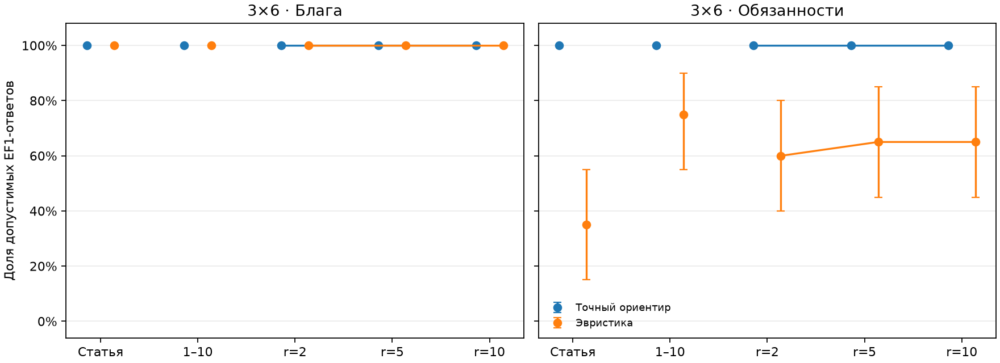
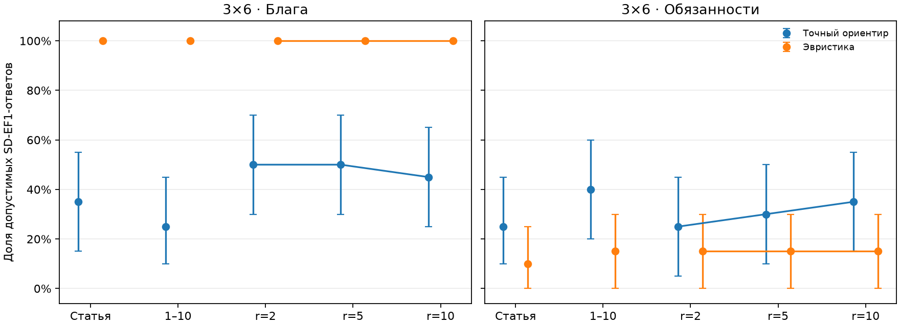
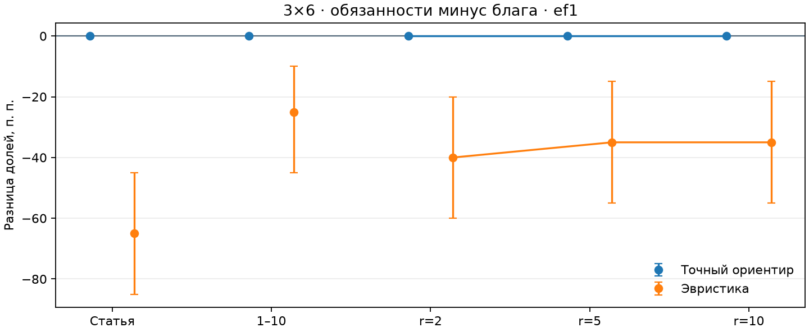

# Алгоритмы · 100 матриц 3×6

Исходный запуск: `runs/e1_20261111T184327_f0969aec`. Журнал завершён, повторный анализ прошёл успешно. Все матрицы имеют размер 3×6; `seed=20261109`, по 20 баз на каждую из групп `paper`, `uniform`, `r=2`, `r=5`, `r=10`. Всего 100 матриц, каждая используется и как блага, и как обязанности.

Выбран завершённый алгоритмический запуск с **20 базами на группу**: всего 100 матриц, 200 задач goods/chores и 400 алгоритмических ответов. Он охватывает все пять предусмотренных групп и показывает различия справедливости и эффективности на более широкой выборке.

Ориентир выполнил EF1 во всех задачах. Эвристика благ выполнила EF1 и SD-EF1 на всех 100 входах. Эвристика обязанностей выполнила EF1 в 60% и SD-EF1 в 14% случаев; её меньшая средняя стоимость достигается без ограничения справедливости.

Это сохранённый запуск предыдущей версии кода от 11 ноября 2026 года. Его исходный `source/` и manifest сохранены без изменения. Все 14 метрик заново пересчитаны текущей версией проверяющего кода и совпали с исходным `results.csv`. Метод всех ориентиров в этом запуске — полный перебор.

В исходной конфигурации `repeats=3`, но модели выключены: повторы относятся только к моделям. Каждый детерминированный алгоритм запускался один раз на задачу. Исходный бюджет перебора — 100 000, при размере 3×6 рассматривается только 729 назначений.

## Основные результаты

| Метод | Режим | Матриц | EF1 | SD-EF1 | Средний d | Средний SW / C |
|---|---|---:|---:|---:|---:|---:|
| Точный ориентир | Блага | 100 | 100% | 41% | 0.000000 | 140.9798 |
| Эвристика | Блага | 100 | 100% | 100% | 0.000000 | 129.2518 |
| Точный ориентир | Обязанности | 100 | 100% | 31% | 0.000000 | 61.3685 |
| Эвристика | Обязанности | 100 | 60% | 14% | 0.062751 | 60.9125 |

Значения в таблице усреднены по экземплярам и всем пяти одинаковым по размеру группам. `d` — доля полной оценки строки; `total` — сумма нормированных баллов: для благ это SW (больше лучше), для обязанностей C (меньше лучше). Строки нормируются к 100. Точный ориентир сначала минимизирует обычное нарушение EF1, затем оптимизирует SW/C; SD-EF1 не входит в его целевую функцию.

## Графики

Точки — средние по базовым матрицам, вертикальные отрезки — 95%-е процентильные бутстрэп-интервалы (3000 выборок по `base_id`, общий `seed=20261110`). Блага и обязанности находятся на отдельных панелях.







Для долей разность -0.4 означает -40 процентных пунктов. При одинаковых исходах бутстрэп-интервал может схлопнуться в точку; это не доказательство отсутствия неопределённости на других входах.

## Состав данных

| Файл | Содержимое |
|---|---|
| `manifest.json` | Исходные настройки, версии Python/пакетов, версия CLI, SHA-256 исходников. |
| `journal.jsonl` | Исходные матрицы, назначения, промпты и сырые финальные ответы модели, если она участвовала. Содержимое скопировано без изменения. |
| `results.csv` | Все исходные результаты по отдельным ответам; совпадение с replay проверено. |
| `references.csv` | Исходные точные ориентиры, статусы и значения критериев. |
| `source/` | Исходный снимок модулей для этого прогона; хеши совпадают с manifest. |
| `config.json` | Конфигурация для запуска через текущий CLI проекта. |
| `summary.csv` | Заново построенная компактная сводка по методу, режиму и группе. |
| `overall.csv` | Общая сводка по методу и режиму, использованная в таблице выше. |
| `bootstrap.csv` | Средние, 95%-е интервалы и число определённых экземпляров для всех метрик. |
| `paired_ef1.csv`, `paired_sd_ef1.csv` | Парные разности chores−goods по каждой группе. |
| `validation.json` | Проверки целостности, происхождение файлов и версия текущего checker. |

Исходные `manifest.json`, `journal.jsonl`, `results.csv`, `references.csv` и снимок `source/` сохранены без изменения. Сводки, конфигурация для текущего CLI и графики построены при подготовке публикации. Модели в этом прогоне не участвовали; все алгоритмические назначения включены в `journal.jsonl`.

## Повторный анализ

Из корня проекта, в окружении с установленным пакетом:

```python
from chores_e1 import analyze_file, summary_table

result = analyze_file("results/algorithms_3x6_n20")
assert result.complete
print(summary_table(result.rows))
```

Или из терминала:

```bash
python -m chores_e1 analyze results/algorithms_3x6_n20
```

Повторный анализ использует сохранённые ответы. Повторный запуск эксперимента через `run` создаёт новые результаты; если в `config.json` заданы модели, он делает новые модельные вызовы.
