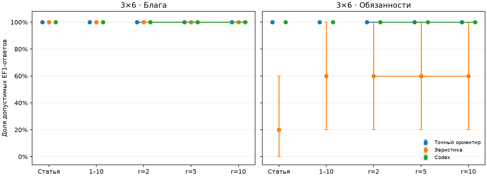
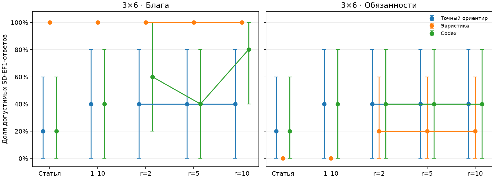
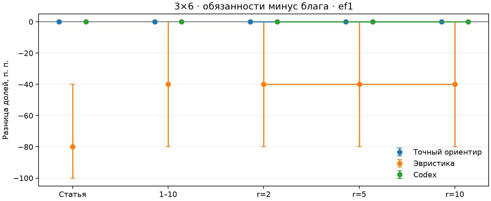

# Модель GPT-6.1 Sol · пилот 3×6

Исходный запуск: `runs/e1_20261112T200746_86a24dab`. Журнал завершён, повторный анализ прошёл успешно. Все матрицы имеют размер 3×6; `seed=20261109`, по 5 баз на каждую из групп `paper`, `uniform`, `r=2`, `r=5`, `r=10`. Всего 25 матриц, каждая используется и как блага, и как обязанности.

Это реальный завершённый запуск `gpt-6.1-sol`: **50 ответов модели**, по одному на каждую из 25 матриц в режимах благ и обязанностей. Фактический ID в сохранённых ответах — `gpt-6.1-sol`.

Модель дала допустимые EF1-распределения в 50 из 50 задач. SD-EF1 выполнена в 12 из 25 задач благ (48%) и 9 из 25 задач обязанностей (36%). Стоимость обязанностей совпала с точным ориентиром на всех 25 задачах; полезность благ — на 24 из 25. В оставшейся задаче (`base_id=1`, `r=10`) потеря полезности составила около 1.7857 балла.

Модельные ответы заняли суммарно около 24 минут. `reasoning_effort` в конфигурации не задан: использовалось значение по умолчанию CLI. Его нельзя интерпретировать как явно зафиксированный уровень рассуждения. Все вызовы прошли через отдельные сессии с отключёнными инструментами и аудитом событий CLI.

По пять матриц на группу — это пилот. Результаты относятся к выбранным входам 3×6 и не доказывают 100%-й успех модели на всех задачах.

## Основные результаты

| Метод | Режим | Матриц | EF1 | SD-EF1 | Средний d | Средний SW / C |
|---|---|---:|---:|---:|---:|---:|
| Точный ориентир | Блага | 25 | 100% | 36% | 0.000000 | 138.4514 |
| Эвристика | Блага | 25 | 100% | 100% | 0.000000 | 127.8505 |
| Codex | Блага | 25 | 100% | 48% | 0.000000 | 138.3800 |
| Точный ориентир | Обязанности | 25 | 100% | 36% | 0.000000 | 64.0635 |
| Эвристика | Обязанности | 25 | 52% | 12% | 0.062580 | 63.3169 |
| Codex | Обязанности | 25 | 100% | 36% | 0.000000 | 64.0635 |

Значения в таблице усреднены по экземплярам и всем пяти одинаковым по размеру группам. `d` — доля полной оценки строки; `total` — сумма нормированных баллов: для благ это SW (больше лучше), для обязанностей C (меньше лучше). Строки нормируются к 100. Точный ориентир сначала минимизирует обычное нарушение EF1, затем оптимизирует SW/C; SD-EF1 не входит в его целевую функцию.

## Графики

Точки — средние по базовым матрицам, вертикальные отрезки — 95%-е процентильные бутстрэп-интервалы (3000 выборок по `base_id`, общий `seed=20261110`). Блага и обязанности находятся на отдельных панелях.







Для долей разность -0.4 означает -40 процентных пунктов. При одинаковых исходах бутстрэп-интервал может схлопнуться в точку; это не доказательство отсутствия неопределённости на других входах.

## Состав данных

| Файл | Содержимое |
|---|---|
| `manifest.json` | Исходные настройки, версии Python/пакетов, версия CLI, SHA-256 исходников. |
| `journal.jsonl` | Исходные матрицы, назначения, промпты и сырые финальные ответы модели, если она участвовала. Содержимое скопировано без изменения. |
| `results.csv` | Все исходные результаты по отдельным ответам; совпадение с replay проверено. |
| `references.csv` | Исходные точные ориентиры, статусы и значения критериев. |
| `source/` | Исходный снимок модулей для этого прогона; хеши совпадают с manifest. |
| `config.json` | Конфигурация для запуска через текущий CLI проекта. |
| `summary.csv` | Заново построенная компактная сводка по методу, режиму и группе. |
| `overall.csv` | Общая сводка по методу и режиму, использованная в таблице выше. |
| `bootstrap.csv` | Средние, 95%-е интервалы и число определённых экземпляров для всех метрик. |
| `paired_ef1.csv`, `paired_sd_ef1.csv` | Парные разности chores−goods по каждой группе. |
| `validation.json` | Проверки целостности, происхождение файлов и версия текущего checker. |

Исходные `manifest.json`, `journal.jsonl`, `results.csv`, `references.csv` и снимок `source/` сохранены без изменения. Сводки, конфигурация для текущего CLI и графики построены при подготовке публикации. Финальные ответы модели уже включены в `journal.jsonl`; служебные файлы сессий Codex из `calls/` не требуются для replay.

## Повторный анализ

Из корня проекта, в окружении с установленным пакетом:

```python
from chores_e1 import analyze_file, summary_table

result = analyze_file("results/model_gpt-6.1-sol")
assert result.complete
print(summary_table(result.rows))
```

Или из терминала:

```bash
python -m chores_e1 analyze results/model_gpt-6.1-sol
```

Повторный анализ использует сохранённые ответы. Повторный запуск эксперимента через `run` создаёт новые результаты; если в `config.json` заданы модели, он делает новые модельные вызовы.
